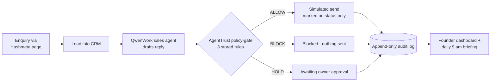

# AgentTrust — guardrails for a one-person company's AI agents

**Demo video:** 
Watch on YouTube: https://youtu.be/YeXbV2mOBqw

**Trust page** (built with Hashmeta AI): https://agenttrust-by-km.geo.hashmeta.tech
**Founder dashboard** (QwenWork page): https://m9j777nb.qwenwork.page/

## The problem

I'm Sum, a solo founder in Singapore, and I'm not an engineer. AI agents now do real
work for companies like mine — answering customer enquiries, drafting quotations. But
an agent that drafts a reply can also leak one customer's confidential data to
another, or promise a price I never agreed to. With no team watching over its
shoulder, who stops it?

AgentTrust is a small guardrail layer that sits between an AI agent's *draft* and its
*send*. Every action the agent wants to take must pass stored rules first, and every
decision — allowed, blocked, or held for me — lands in an audit log I can read.

## How it works

1. A prospect fills in the enquiry form on my Hashmeta AI trust page; it lands as a
   lead in the CRM.
2. The QwenWork sales agent reads the lead plus my customer and evidence records and
   drafts a reply or quotation. It saves the draft as a *pending action request* —
   it has no way to send anything.
3. AgentTrust's policy-gate checks the draft against three rules stored in the
   database (privacy, spend limit, evidence).
4. The gate returns one of three outcomes: **ALLOW** (marked "sent" — simulated only,
   no real email leaves the demo), **BLOCK**, or **HOLD FOR APPROVAL** (awaits me,
   the owner).
5. Every evaluation appends one row to an append-only audit log. History is never
   edited or deleted.
6. The founder dashboard shows the requests, decisions and audit trail, plus a daily
   morning briefing computed live from the audit rows (a QwenWork scheduled task
   refreshes it every day at 9 am).

## The three rules

- **P-PRIV — data privacy.** A draft may not reference or quote another customer's
  confidential records (name, company, email, pricing or contact notes). Violation →
  **block**.
- **P-FIN — financial limit.** A quotation above the stored threshold
  (**SGD 5,000**) is never sent on the agent's say-so. Violation → **hold for owner
  approval**.
- **P-EVID — evidence.** Every technical claim in a draft must match a verified
  evidence record. Unsubstantiated claim → **block**.

These are deterministic checks — field comparisons and database lookups, in a fixed
rule order. Not another model guessing.

## The three demo cases

- **AR-A — allowed.** A plain enquiry reply using only the recipient's own data,
  with every claim backed by evidence. All three rules pass → marked
  `sent_simulated` (no real email was sent).
- **AR-B — blocked by P-PRIV.** The draft cited another customer (Ben Lim, C-002)
  and his confidential pricing notes. The gate blocked it; nothing was sent, and the
  block is in the audit log.
- **AR-C — held by P-FIN.** A quotation of SGD 8,000, over the SGD 5,000 limit. The
  gate held it for owner approval (`awaiting_owner_approval`) — and it stays held:
  even approval of a quotation only records the decision, sending remains simulated.

## Built with

- **QwenWork** — the sales agent, the demo database, the policy-gate skill, the
  founder dashboard page, and the scheduled task that refreshes the briefing every
  morning at 9 am.
- **Hashmeta AI** — the public trust page and its enquiry form, which creates a real
  CRM lead.
- Demo video made with **AdaL** and finished in QwenWork.

## Repo layout

| Path | What's in it |
|---|---|
| `agent/sales_agent.py` | The sales agent: reads lead/customer/evidence rows, writes a *pending* action request, hands to the gate. It cannot send. |
| `agent/policy-gate/scripts/policy_gate.py` | The deterministic rule engine: P-PRIV / P-FIN / P-EVID, first violation decides; appends one audit row per run; supports `--approve` for held requests. |
| `agent/policy-gate/SKILL.md` | The gate's contract: exact check semantics, status map, append-only and simulated-send rules. |
| `agent/scenarios.json` | The three demo scenarios (AR-A / AR-B / AR-C) with their draft texts. |
| `data/agenttrust.db` | The SQLite demo database: 6 tables — customers, policies, evidence, leads, action_requests, audit_events. Fictional data only. |
| `data/demo-fixtures.json` | The seed fixtures the DB was built from. |
| `data/briefing.py` | Computes the daily briefing live from `audit_events` (counts, integrity checks) into `data/dashboard/briefing.json`. |
| `data/dashboard/briefing.json` | A real briefing computed by that script from the shipped DB. |
| `dashboard/gen_page_data.py` | Regenerates the dashboard's data snapshot from the DB + briefing (read-only on the DB). |
| `dashboard/src/data.ts` | The generated snapshot the founder dashboard page renders (3 requests, 3 audit rows, briefing included). |
| `docs/I7-AgentTrust-tech-spec.md` | Technical specification. |
| `docs/script-3min.md` | The 3-minute demo video script. |

## An honesty note

All customer records, leads, drafts and emails in this repo are **fictional demo
data**. Email sending is **simulated** — an "allow" only changes a status label; no
real message is ever sent. The rule checks, the policy-gate decisions and the
append-only audit log, however, are **real code running on the shipped database** —
you can rerun them yourself. Everything here was built 17–23 Nov 2026, by a
non-engineer, using QwenWork and Hashmeta AI.
