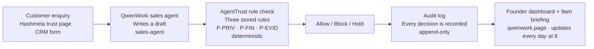

# AgentTrust — 3-minute demo script (single video)

Locked script for the QwenWork x Hashmeta AI OPC Hackathon entry (I7 AgentTrust). One video only. Hard cap **3:00**. Target cut **2:45**.

Use this with `adal-brief.md`. AdaL (Sylph) should produce the video from this script; do not film a second cut unless this one overruns or a live label has changed.

## Production facts (do not invent)

| Item | Fact |
|---|---|
| Founder | Sum (KM Sum), solo founder in Singapore. No software-engineering background. Never claim official Cognition ambassador status. |
| Voice | Female voiceover, first person, plain and casual, as Sum. No hype, no jargon. Burned-in English captions for every spoken line. |
| Trust page (Hashmeta) | https://agenttrust-by-km.geo.hashmeta.tech |
| Founder dashboard (QwenWork) | https://m9j777nb.qwenwork.page/ |
| Scenarios, already tested | Data leak blocked; SGD 8,000 quote held (above the SGD 5,000 rule); normal reply allowed. |
| Briefing | Shown at the top of the live dashboard. The page says it is read automatically from the record and refreshed every day at 9. Read-only — never approves or sends. |
| Honesty | All customer records are fictional. Email sending is simulated. The rule checks and the log are real. |
| Live dashboard note | The public dashboard is read-only. There is no approve button on that page. The live copy says: "This page can't approve anything — approvals that don't get recorded don't count. Approve via the AgentTrust session — the approval is logged." Do not fake a click on a button that is not there. |
| Models | The product is built on QwenWork. The policy check in the live technical-details table is labelled `none (deterministic rule engine)`, tokens `0`. Say that honestly. Do not claim a Qwen model is doing the allow/block/hold decision. Do not name a drafting model unless KM confirms one. |

Judging weights to hit on screen: Innovation 25%, Feasibility & Viability 25%, Use of QwenWork 20%, Demo presentation 15%, Website built with Hashmeta AI 15%.

## Runtime and word count

- Voiceover: **319 words**, locked below (was 341; the new "How it works" beat is 54 words, and other beats were trimmed by 76 words).
- Speech only: **2:16** at 140 wpm, **2:27** at 130 wpm.
- Planned picture holds: **12 seconds** total (leak draft ~4s, quote ~3s, briefing ~2s, end card ~3s).
- Estimated cut: **~2:28–2:35** at 140 wpm with those holds; **~2:39–2:45** at 130 wpm. End-card pad may run to **2:45**.
- If the generated voice is slower than 130 wpm, trim holds and the end card first, not lines, and re-time. Never exceed 3:00.

If the live briefing counts have changed since this script was written, **update the briefing voiceover to match the numbers on screen**. Do not say "three actions" if the page shows something else.

The live dashboard copy was refreshed on 22 November 2026 (last update on the page: 22 Nov, 6:36 PM SGT). Shot directions below use the current labels. If a heading has changed again, follow the live page.

## Full voiceover (read as one piece)

I'm Sum, a solo founder in Singapore — not an engineer. I use AI agents in my one-person company, but I need to know they won't send the wrong thing.

Here's how it works. An enquiry lands on my Hashmeta page, into my CRM. A QwenWork sales agent writes a draft. AgentTrust checks three stored rules — not another model guessing. The result is allow, block, or hold for me. Each decision goes into a log on my QwenWork dashboard, updated every morning at nine.

Here's the hero case. A sales agent drafts a reply to Aria Tan. It looks helpful, but it names another customer — Ben Lim, his company, his email, and what he pays. That's a leak. AgentTrust blocked the send. Nothing went out. The log shows P-PRIV, blocked, and why.

Next, a quote for Aria: eight thousand Singapore dollars. Anything above five thousand needs my approval. AgentTrust did not reject it, and it did not send it. It held it — P-FIN, not sent. I approve it in the AgentTrust session, and that yes is logged.

When a reply is clean, it is allowed. This one to Aria uses only her data, stays under the limit, and the claims have evidence. The send is simulated — no real email left the system. The log shows who asked, which rule, the outcome, and why.

Today's briefing is right at the top, from this log: three actions, one sent, one blocked for privacy, one waiting for me. No unauthorised transaction went through. Read-only — it never approves or sends.

Back on the Hashmeta page: the three rules, a link to the dashboard, and the enquiry form. I'm not an engineer. The records are fictional. The rule checks and the log are real. That's why this is feasible for a one-person company.

AgentTrust is simple: allow, block, or hold for my approval. I stay in control, and I can show my work. Thank you.

## How it works — tech stack diagram

Show this as a clean Remotion-drawn diagram (not an AI-generated image — type must stay sharp) during the 0:13–0:37 beat. 1920×1080, generous margins, high contrast, plain words in the boxes, tiny grey labels under the main line for the real names. Animate the six steps in sync with the voiceover. Do not add unverified boxes (no model name, no MCP, no Filigrain, no Routero).

### Box text (exact)

1. **Customer enquiry**  
   Grey: `Hashmeta trust page · CRM form`
2. **QwenWork sales agent**  
   Main second line: `Writes a draft`  
   Grey: `sales-agent`
3. **AgentTrust rule check**  
   Main second line: `Three stored rules`  
   Grey: `P-PRIV · P-FIN · P-EVID · deterministic`
4. **Allow / Block / Hold**  
   Three equal pills, not a single vague "decision" box.  
   Grey: `nothing goes out until this step`
5. **Audit log**  
   Main second line: `Every decision is recorded`  
   Grey: `append-only`
6. **Founder dashboard + 9am briefing**  
   Grey: `qwenwork.page · updates every day at 9`

### Arrow order (sync to the voice)

1. On "An enquiry lands on my Hashmeta page, into my CRM" — box 1 lights up.
2. On "A QwenWork sales agent writes a draft" — arrow 1→2, box 2 lights up.
3. On "AgentTrust checks three stored rules" — arrow 2→3, box 3 lights up. The three grey rule codes can tick in.
4. On "The result is allow, block, or hold for me" — arrow 3→4, the three pills light up in order: Allow, Block, Hold.
5. On "Each decision goes into a log" — arrow 4→5, box 5 lights up.
6. On "on my QwenWork dashboard, updated every morning at nine" — arrow 5→6, box 6 lights up. Hold the completed diagram for a beat, then cut to the live dashboard for the hero case.

Layout: one horizontal row on 16:9 if the type stays readable at 1080p; otherwise two rows (1–3 on top, 4–6 below) with the same arrow order. No decorative 3D, no fake screenshots inside the boxes.

### Mermaid (same stack)

### Evidenced vs unverified

Evidenced on the live pages or by KM, and therefore in the diagram:

- Hashmeta-built trust page, with an enquiry form that says details go "straight into my CRM", and a link to the founder dashboard.
- QwenWork dashboard at `m9j777nb.qwenwork.page`, with `sales-agent` writing `send_reply` and `send_quotation` drafts.
- Three stored rules `P-PRIV`, `P-FIN`, `P-EVID`.
- Outcomes allow / block / hold (trust page wording: ALLOW, BLOCK, HOLD FOR APPROVAL; live dashboard wording: Sent (demo), Blocked, Waiting for you).
- Append-only style log in "Show technical details"; `model used` is `none (deterministic rule engine)`, tokens `0`.
- Simulated send; fictional customer data.
- Dashboard "read automatically from the record and refreshed every day at 9".

Left out of the diagram, for KM to confirm if he wants them on screen:

- Which QwenWork-provided model writes the sales drafts (the live table's `model used` field describes the rule check, not the drafter).
- Whether the Hashmeta enquiry form is actually wired into a Hashmeta CRM record that the sales agent then picks up, or only described on the page.
- Whether a Hashmeta MCP connection is in use.
- Whether the 9am refresh is specifically a QwenWork scheduled task (KM said the briefing was scheduled; the live page says the dashboard is refreshed every day at 9, but does not name the scheduler).

## Timed beats

Picture must be the **live sites**, not AI-generated UI, except for the Remotion stack diagram in beat 0:13–0:37. Use real screenshots or a real screen recording, with Remotion zooms, highlights, and callouts. Story order is not page order: after the diagram, show the leak first, even though "Needs your decision" sits just above "Blocked" on the dashboard (page order: Needs your decision, Blocked, The three rules, Activity, Allowed).

Captions are required: burn in English captions for every spoken line, word-timed to the audio, matching the locked script spelling. The Caption column is the preferred line breaks. Keep them in a safe lower-third so they do not cover decision badges, the diagram boxes, or the briefing quote.

| Time | On-screen shot / URL / action | Voiceover | Caption | Criteria |
|---|---|---|---|---|
| 0:00–0:13 | Open **https://agenttrust-by-km.geo.hashmeta.tech**. Hold on the hero: heading **How my AI agents are governed**, and the line *I'm Sum, a solo founder in Singapore — not an engineer.* Soft title card, lower-left: `AgentTrust` / `Sum (KM Sum), Singapore`. | I'm Sum, a solo founder in Singapore — not an engineer. I use AI agents in my one-person company, but I need to know they won't send the wrong thing. | I'm Sum, a solo founder in Singapore — not an engineer. / I use AI agents in my one-person company, / but I need to know they won't send the wrong thing. | Demo 15%; Hashmeta 15% (page is visible from the first second) |
| 0:13–0:37 | Cut to the Remotion **tech stack diagram** specified above. Animate boxes and arrows in the six-step order, in sync with the voice. Do not generate this diagram with a video or image model. At the last line, the completed diagram holds, then a short dissolve toward the dashboard. | Here's how it works. An enquiry lands on my Hashmeta page, into my CRM. A QwenWork sales agent writes a draft. AgentTrust checks three stored rules — not another model guessing. The result is allow, block, or hold for me. Each decision goes into a log on my QwenWork dashboard, updated every morning at nine. | Here's how it works. / An enquiry lands on my Hashmeta page, into my CRM. / A QwenWork sales agent writes a draft. / AgentTrust checks three stored rules — not another model guessing. / The result is allow, block, or hold for me. / Each decision goes into a log on my QwenWork dashboard, / updated every morning at nine. | Use of QwenWork 20%; Hashmeta 15%; Innovation 25%; Feasibility 25%; Demo 15% |
| 0:37–1:02 | Open **https://m9j777nb.qwenwork.page/** (via the trust-page link **Live founder dashboard — every decision recorded** if that cut is clean). Show the heading *Is my AI agent behaving?* for ~2s, then scroll to **Blocked**, card `AR-B`. Zoom the draft and highlight *Ben Lim*, *Orchid Retail Pte Ltd*, *ben.lim@example.com*, *SGD 7,500*. Hold ~4s so the draft can be read. Show the explanation: *Draft includes confidential records of Ben Lim (C-002)…* Red callout: `Blocked` / `P-PRIV`. Optionally open **Show technical details** on row `AEV-AR-B-01`. | Here's the hero case. A sales agent drafts a reply to Aria Tan. It looks helpful, but it names another customer — Ben Lim, his company, his email, and what he pays. That's a leak. AgentTrust blocked the send. Nothing went out. The log shows P-PRIV, blocked, and why. | Here's the hero case. / A sales agent drafts a reply to Aria Tan. / It looks helpful, but it names another customer — / Ben Lim, his company, his email, and what he pays. / That's a leak. / AgentTrust blocked the send. Nothing went out. / The log shows P-PRIV, blocked, and why. | Innovation 25%; Feasibility 25%; Use of QwenWork 20%; Demo 15% |
| 1:02–1:24 | Scroll to **Needs your decision** / **Waiting for you**, card `AR-C`. Highlight *A quote for Aria Tan (Novacraft Pte Ltd) — SGD 8,000* and *Quote of SGD 8,000 exceeds the SGD 5,000 limit. Held for owner approval; not sent.* Amber callout: `Waiting for you` / `P-FIN` / `not sent`. Hold ~3s on the quote. Do **not** click an approve button on this page (there isn't one). A small on-screen note may quote the live line: *This page can't approve anything… Approve via the AgentTrust session — the approval is logged.* | Next, a quote for Aria: eight thousand Singapore dollars. Anything above five thousand needs my approval. AgentTrust did not reject it, and it did not send it. It held it — P-FIN, not sent. I approve it in the AgentTrust session, and that yes is logged. | Next, a quote for Aria: eight thousand Singapore dollars. / Anything above five thousand needs my approval. / AgentTrust did not reject it, and it did not send it. / It held it — P-FIN, not sent. / I approve it in the AgentTrust session, and that yes is logged. | Innovation 25%; Feasibility 25%; Use of QwenWork 20%; Demo 15% |
| 1:24–1:44 | Scroll to **Allowed (demo, email not really sent)**, card `AR-A`. Show *Sent (demo)* and *no real email left the system*, plus the clean reply to Aria (her data only, *SGD 3,200*, *5 business days*). Green callout: `Sent (demo)`. Then open **Show technical details** and pan the table so these columns are readable: `request`, `who ran it`, `attempted action`, `rule`, `decision`, `why`, `model used`. Highlight rows `AR-A`, `AR-B`, `AR-C`. Highlight `model used`: *none (deterministic rule engine)*. | When a reply is clean, it is allowed. This one to Aria uses only her data, stays under the limit, and the claims have evidence. The send is simulated — no real email left the system. The log shows who asked, which rule, the outcome, and why. | When a reply is clean, it is allowed. / This one to Aria uses only her data, stays under the limit, / and the claims have evidence. / The send is simulated — no real email left the system. / The log shows who asked, which rule, the outcome, and why. | Innovation 25%; Feasibility 25%; Use of QwenWork 20%; Demo 15% |
| 1:44–2:00 | Scroll back to the top of the dashboard. Hold the briefing line *Today, 3 agent actions were processed. 1 was sent, 1 was blocked for privacy, and 1 requires your approval. No unauthorized financial transactions were completed.* and the three counters (*1 Sent*, *1 Blocked*, *1 Needs you*). Also show the footer: *Everything on this page is read automatically from the record and refreshed every day at 9 — nothing here is typed in by hand.* Small callout: *9am · read-only · never approves or sends.* Hold ~2s on the briefing sentence. If live counts differ, change only that voiceover clause to match. | Today's briefing is right at the top, from this log: three actions, one sent, one blocked for privacy, one waiting for me. No unauthorised transaction went through. Read-only — it never approves or sends. | Today's briefing is right at the top, from this log: / three actions, one sent, one blocked for privacy, one waiting for me. / No unauthorised transaction went through. / Read-only — it never approves or sends. | Feasibility 25%; Use of QwenWork 20% |
| 2:00–2:18 | Cut back to **https://agenttrust-by-km.geo.hashmeta.tech**. Quick recap of the three rule cards, then the **Honesty note**, the **Live founder dashboard** link, and **Send an enquiry** (*Your details go straight into my CRM as an enquiry.*). Show the form. Do **not** submit it. | Back on the Hashmeta page: the three rules, a link to the dashboard, and the enquiry form. I'm not an engineer. The records are fictional. The rule checks and the log are real. That's why this is feasible for a one-person company. | Back on the Hashmeta page: / the three rules, a link to the dashboard, and the enquiry form. / I'm not an engineer. / The records are fictional. The rule checks and the log are real. / That's why this is feasible for a one-person company. | Feasibility 25%; Hashmeta 15%; Demo 15% |
| 2:18–2:28 | Tight pull back to the trust-page heading, then fade to an end card. | AgentTrust is simple: allow, block, or hold for my approval. I stay in control, and I can show my work. Thank you. | AgentTrust is simple: allow, block, or hold for my approval. / I stay in control, and I can show my work. / Thank you. | Demo 15%; Innovation 25% |
| 2:28–2:40 | End card, 1920×1080, sharp Remotion type, no AI-generated text in the card: **AgentTrust** / Sum (KM Sum), Singapore / Trust page: `https://agenttrust-by-km.geo.hashmeta.tech` / Dashboard: `https://m9j777nb.qwenwork.page/` / QwenWork x Hashmeta AI OPC Hackathon. Soft music only. No new voiceover. May hold to **2:45**, never past **3:00**. | *(silence)* | *(none)* | Hashmeta 15%; Demo 15% |

Times above assume about 140 wpm plus the planned holds, landing near **2:30–2:40**. At 130 wpm the same words land near **2:39–2:45** if the end card is kept short.

## On-screen labels to match exactly

Pulled from the live pages on 22 November 2026, Asia/Singapore (dashboard footer: last update 22 Nov, 6:36 PM SGT). If a label has changed, follow the live page, not this list.

**Trust page**

- How my AI agents are governed
- I'm Sum, a solo founder in Singapore — not an engineer.
- The three rules: Data privacy / Financial authority / Evidence
- Outcomes: ALLOW / BLOCK / HOLD FOR APPROVAL
- Honesty note: live demo; fictional customer records; email sending is simulated; rule checks and records are real
- Live founder dashboard — every decision recorded
- Send an enquiry — "Your details go straight into my CRM as an enquiry."

**Dashboard**

- Heading: Is my AI agent behaving?
- Briefing at the top: "Today, 3 agent actions were processed. 1 was sent, 1 was blocked for privacy, and 1 requires your approval. No unauthorized financial transactions were completed."
- Counters: 1 Sent (passed every rule, demo send); 1 Blocked; 1 Needs you
- Needs your decision / Waiting for you: `AR-C` — A quote for Aria Tan (Novacraft Pte Ltd) — SGD 8,000. Held for owner approval; not sent. "This page can't approve anything…"
- The three rules, in plain words, with codes `P-PRIV`, `P-FIN`, `P-EVID`
- Activity list, then **Show technical details** table. `who ran it` is `sales-agent`. `model used` is `none (deterministic rule engine)`, tokens `0`. Decisions in the table: "Sent (demo — email not really sent)", "Blocked", "Waiting for you"
- Blocked `AR-B`: draft names Ben Lim at Orchid Retail Pte Ltd (ben.lim@example.com)
- Allowed (demo, email not really sent) `AR-A`: "no real email left the system"
- Footer: "Everything on this page is read automatically from the record and refreshed every day at 9 — nothing here is typed in by hand."

## Picture and sound rules

1. One video, 16:9, 1920×1080, 30 fps, MP4, length **≤ 3:00**, target **2:45**.
2. Show the real product. Do not generate a fake dashboard or trust page with a video model — on-screen text will be wrong, and judges need the live sites. The only fully drawn graphic is the Remotion tech stack diagram.
3. Cursor or highlight motion can be added, but do not invent UI chrome (no fake Approve button on the public dashboard).
4. Voice: **female** only. Calm, conversational, moderate pace, no trailer voice. AdaL may generate the voiceover from this locked script. If a replacement recording is used, it must still be a female voice, of the same locked words.
5. Captions: **burn in** English captions for every spoken line, word-timed to the audio, readable over the UI (safe lower-third, not covering the diagram boxes, decision badges, or the briefing quote).
6. Music: quiet, ducked under speech. No lyrical track. No stock "tech epic" stingers on every cut.
7. A short "fictional demo data" bug or corner label may stay on screen after the hero case begins, but keep it small.

## What this script deliberately skips

- A second video or a longer walkthrough.
- Walking through four agent types, Filigrain, Routero, unofficial gateways, a named drafting model, or a Hashmeta MCP connection — none of those are evidenced on the live pages.
- Submitting the Hashmeta enquiry form, sending a real email, or entering real customer data.
- Inflating KM's experience or claiming any official ambassador role.
